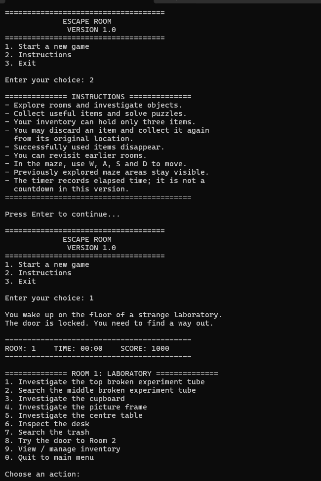
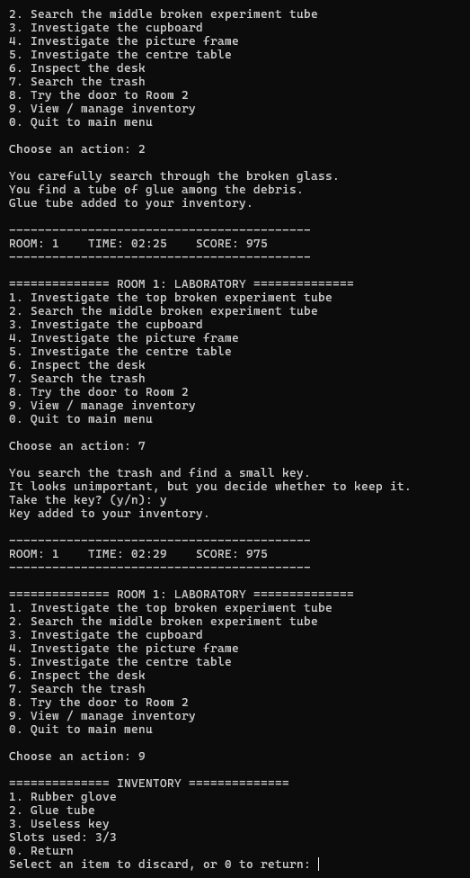

# Escape Room: A Text-Based Adventure in C

## Section A: Project Introduction

Escape Room is a console-based adventure game written in C for the Programming Fundamentals (CS-1002) course. The player wakes up locked inside a laboratory and must escape the building by exploring three connected areas, collecting items, solving puzzles and crossing a maze. The core objective is to apply fundamental C concepts (structures, pointers, arrays, 2D arrays, functions, string handling and safe input validation) in a complete, interactive program. The main features implemented are a randomised four-digit door code, four randomly selected maze layouts with fog-of-war, a three-slot inventory system with item pickup, discard and consumption, clue-based puzzles across three rooms, a score and elapsed-time system with penalties, and robust input handling that re-prompts the user on invalid entries.

---

## Section B: Features & Test Cases (Execution Scenarios)

### Case 1: Main Menu & Instructions
- **Description:** Tests the main menu loop, which lets the player start a game, read the instructions or exit, and keeps showing the menu until Exit is chosen.
- **Inputs:** `2` (Instructions), press Enter, then `1` (Start a new game).
- **Expected Output:** The instructions screen lists the rules (3-item inventory, W/A/S/D maze controls, count-up timer). After pressing Enter the menu returns. Choosing `1` prints "You wake up on the floor of a strange laboratory." and opens Room 1 with the status bar (`ROOM`, `TIME`, `SCORE: 1000`).
- **Screenshot:** 

### Case 2: Room 1 Clue Collection & Unlocking the Door
- **Description:** Tests searching objects in the Laboratory to collect the four coloured digits (BLUE, RED, GREEN, YELLOW) and entering the code in the correct door order (GREEN, BLUE, YELLOW, RED). The digits are random each game.
- **Inputs:** `1` (top tube), `3` (cupboard), `4` then `SHADOW` (picture frame riddle), `5` then `LAB` (centre table puzzle), then `8` (door) and the code, e.g. if BLUE=3, RED=7, GREEN=1, YELLOW=9 enter `1397`.
- **Expected Output:** Each search reveals its coloured digit (e.g. "Inside, you find a digit marked BLUE: 3"). The door shows the slot order `GREEN BLUE YELLOW RED`. A correct code prints "The lock clicks open. You enter Room 2." and moves the player to Room 2.
- - **Screenshot:** _execution.png)
  - - **Screenshot:** _execution.png)

### Case 3: Inventory Management (Pickup, Capacity & Discard)
- **Description:** Tests the three-slot inventory: picking up items, being blocked when full, discarding an item back to its original location and collecting it again.
- **Inputs:** In Room 1: `2` (search broken tube, glue), `3` then `y` (take glove), `7` then `y` (take key), then `9` to open the inventory. Try picking up a fourth item, then discard one using its number.
- **Expected Output:** Items are listed as `1. Glue tube`, `2. Rubber glove`, `3. Useless key` with "Slots used: 3/3". A fourth pickup prints "Your inventory is full. Discard an item before collecting this one." Discarding prints "<item> returned to its original location." and the item can be collected again from where it was found.
- - **Screenshot:** 

### Case 4: Room 2 Puzzle Chain (Wardrobe, Computer, Statue Key)
- **Description:** Tests the multi-step puzzle in the Statue Room: finding the password, reading the computer, obtaining the statue key and exchanging it for the Room 3 key.
- **Inputs:** `2` twice (wardrobe), `4` then `1997` (computer), `1` (toilet), `3` then `y` (statue and use key), then `6` (door to Room 3).
- **Expected Output:** The first wardrobe search finds nothing, the second reveals the password `1997`. The computer prints "ACCESS GRANTED." and a backstory passage. The toilet gives the Statue key; using it prints "The key fits. A compartment opens in the statue." and adds the Room 3 key. Option `6` unlocks the door and enters Room 3.

### Case 5: Maze Navigation with Fog-of-War
- **Description:** Tests movement through a randomly selected maze layout, wall collision, the explored-area display and the ability to leave and resume.
- **Inputs:** `W`, `A`, `S`, `D` (one key per move, lowercase also accepted), a move into a wall, and `B` to go back to Room 2, then re-enter Room 3.
- **Expected Output:** The map shows `@` (player), `?` (unexplored), `#` (wall), `.` (path), with only adjacent cells revealed and explored cells staying visible. Walking into a wall prints "A wall blocks your way." Each step adds 2 seconds to the timer. `B` returns to Room 2 with "Your maze progress is saved." Reaching `E` prints "You have reached the far side of the maze!" and the maze is bypassed on later visits.

### Case 6: Final Area & Escaping the Building
- **Description:** Tests the final puzzles in Room 3 and the winning condition, which requires the rubber glove for the fingerprint scanner.
- **Inputs:** `1` then `GLOVE` (table puzzle), `2` then `y` (safe with the small key), `3` (glue on cracked panel), `4` then `y` (use glove on scanner).
- **Expected Output:** The table puzzle prints a hint and awards +25 points. The safe opens with a click and reveals a backstory passage. The glue repairs the panel (+25 points). Using the glove on the scanner prints "The lock releases. You step outside." followed by the "YOU ESCAPED!" banner, the final time and the final score.

### Case 7: Score, Timer & Penalties
- **Description:** Tests the scoring system that starts at 1000 points and applies time and point penalties for mistakes and wasted actions.
- **Inputs:** Enter a wrong door code in Room 1, give a wrong riddle answer, enter the spiral passage in Room 2 and search the broken tube for debris.
- **Expected Output:** The status bar updates after each action. A wrong door code costs 10 seconds and 25 points, a wrong puzzle answer costs 5 seconds and 15 points, the spiral passage dead end costs 30 seconds and 10 points (first visit only), and searching the broken glass costs 15 seconds. The score never drops below 0 and the final time includes all penalties.
- - **Screenshot:** _execution.png)

### Case 8: Invalid Input & Error Handling
- **Description:** Tests how the program handles unexpected inputs at menus, yes/no prompts, maze controls, locked doors and missing items.
- **Inputs:** `abc`, `5x`, `99` and an empty line at a menu; `maybe` at a yes/no prompt; `WW` and `X` in the maze; an overlong string at a text prompt; the door to Room 3 without its key; the scanner without the glove.
- **Expected Output:** Non-numeric entries print "Please enter a valid whole number." and re-prompt. Out-of-range numbers print "Invalid choice." Yes/no prompts print "Please enter Y or N." until valid. Maze errors print "Enter one movement key at a time." or "Unknown movement key." Locked doors print "The door is locked. You need its key." and the scanner prints "You cannot operate the scanner without the rubber glove." The program never crashes and extra input is safely discarded.
